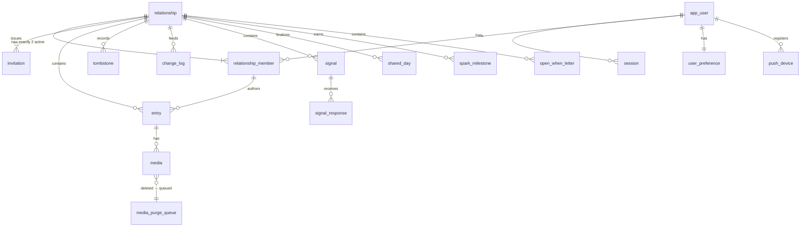

# Draft data model

The executable draft is [`spikes/data-model/schema.sql`](../../spikes/data-model/schema.sql), verified by 25 database-level tests on real PostgreSQL (PGlite), including a characterization test for the known Open When gap, in [F-05](../feasibility/F-05-data-model.md). **Status: draft for review.** Phase 2 ports it to the chosen migration tool.

## Tables at a glance

| Table                       | Purpose                    | Notable constraints                                                                                                                                                                  |
| --------------------------- | -------------------------- | ------------------------------------------------------------------------------------------------------------------------------------------------------------------------------------ |
| `app_user`                  | Account                    | Lower-cased unique email; argon2id hash; not readable by the app role                                                                                                                |
| `session`                   | Login sessions             | Only the token's SHA-256 is stored                                                                                                                                                   |
| `relationship`              | The private space          | `reference_time_zone` (D-13); `day_cutoff` NULL until U-02                                                                                                                           |
| `relationship_member`       | Partners                   | Trigger: ≤ 2 active (row lock against races); unique active membership per user                                                                                                      |
| `invitation`                | Pairing                    | Hashed token; ≤ 24 h; `accept_invitation()` is atomic, single-use, user taken from context                                                                                           |
| `entry`                     | Day Log items              | Client UUIDv7 id; composite FK author ∈ relationship; visibility/shared_at consistency; read-only after reveal; shared → private forbidden; version bump on update                   |
| `media`                     | Attachments                | Composite FK (entry, relationship): no cross-relationship pointers; cascade on entry delete                                                                                          |
| `media_purge_queue`         | Guaranteed object deletion | Filled by trigger on media delete (transactional outbox)                                                                                                                             |
| `tombstone`                 | Deleted ids                | Content-free; blocks re-insertion (`GN410`); retention U-15                                                                                                                          |
| `change_log`                | Sync feed                  | Ids only; `visible_to` = author for private rows; `mutation_id` for acknowledgements                                                                                                 |
| `processed_mutation`        | Idempotency                | Fingerprint + outcome only; bounded retention                                                                                                                                        |
| `signal`, `signal_response` | Signals                    | No read/seen/escalation tables, by design; `expires_at` for retention (U-09)                                                                                                         |
| `shared_day`                | Finalized days             | **No per-partner columns** (P-09), verified by an introspection test                                                                                                                 |
| `spark_milestone`           | Earned milestones          | Primary key (relationship, milestone): earned once, kept forever                                                                                                                     |
| `open_when_letter`          | Letters                    | Recipient sees only sealed or opened letters (RLS). **Gap:** RLS exposes the body of a sealed, unopened letter to the recipient; hiding it until opened is unenforced and unverified |
| `user_preference`           | Per-person settings        | Defaults: generic previews, quiet hours on; private to the user                                                                                                                      |
| `push_device`               | Push tokens                | Not readable by the app role directly                                                                                                                                                |

## Custom error codes

| Code    | Meaning                               | API mapping       |
| ------- | ------------------------------------- | ----------------- |
| `GN401` | No authenticated user in context      | 401               |
| `GN403` | Invitation not valid (any reason)     | 403, generic copy |
| `GN409` | Relationship already has two partners | 409               |
| `GN410` | Entity was deleted (tombstone)        | 410 → `gone`      |
| `GN422` | Shared entry cannot become private    | 422               |
| `GN423` | Entry is read-only (revealed recap)   | 423               |

## Open questions affecting the schema

U-05 late window (may add `late_window` to relationship) · U-08 media limits (check constraints) · U-09 signal retention · U-15 tombstone and idempotency retention · U-16 deletion actor (would add a column) · U-19/U-27 multiple devices (planned, P-36; `session` currently has no device identity and `push_device` is not linked to sessions) · U-20 account deletion behaviour (FKs deliberately block cascades from users to entries).
