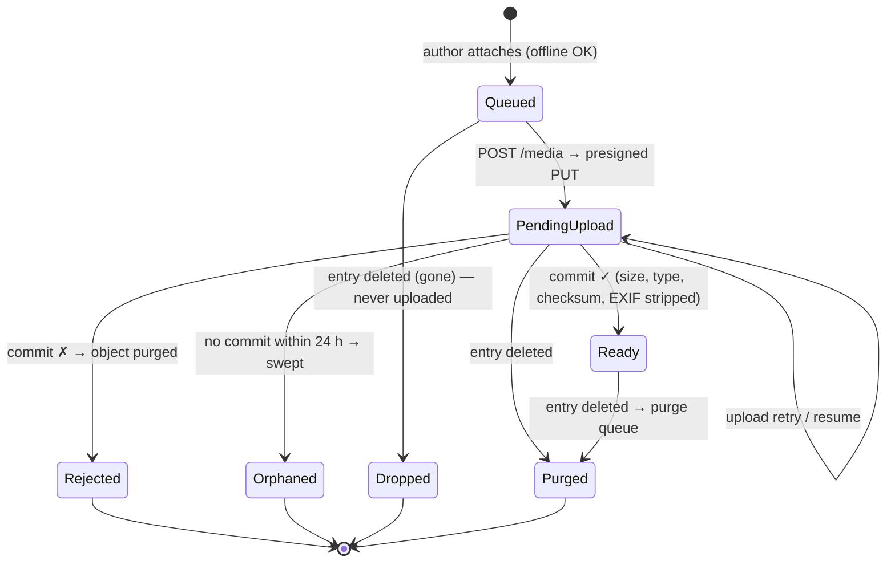

# Media lifecycle

Decision: [ADR-0005](../decisions/adr/0005-media-pipeline.md). Limits: U-08. Provider and region: U-07.

## Rules

1. Private bucket only; access via presigned URLs valid for minutes, issued after authorization.
2. Object keys are random and opaque.
3. Validate by content (magic bytes), size and checksum on commit, not by the client's claim.
4. Strip location and device EXIF from photos (P-21). Generate thumbnails server-side.
5. Deletion: the media row cascades from the entry; a trigger enqueues the key; the purge job retries until the object is gone. The enqueue trigger is tested at the database level (F-05). The purge worker, retry after a storage outage, and actual object deletion are verified **locally** in F-07.
6. A stale device's queued upload for a deleted entry is answered `gone` and dropped. This is shown in the F-04 in-memory simulation only. Server-side retry is verified locally in F-07. Phone background upload is B-43 (**not verified**).
7. **Late uploads after deletion (F-07 finding 1):** a still-valid presigned URL can upload after its entry was deleted and purged. A periodic **storage reconciliation** deletes objects no media row references, and presign TTLs are kept short (P-38).
8. **Every storage call has a hard deadline** (F-07 finding 2): SDK handler timeouts did not bound calls to a frozen backend.
9. **Commit requests carry the entry id** (F-07 finding 3), so a commit after deletion answers `gone`.
10. Backups: object storage versioning or lifecycle rules must not keep deleted media longer than the stated backup retention (U-07).

## Cost inputs (for U-07 / U-08)

Two users. Estimate per month: photos × average size, video minutes × bitrate, voice minutes, plus thumbnails, egress for viewing, and backup copies. Model it once U-08 caps are chosen.
