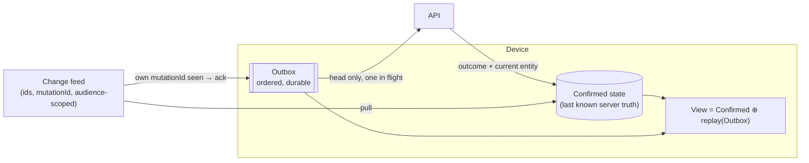

# Offline sync

Decision and rationale: [ADR-0003](../decisions/adr/0003-offline-sync-model.md). Evidence and bugs found: [F-04](../feasibility/F-04-offline-sync.md). Reference implementation: [`spikes/offline-sync`](../../spikes/offline-sync/).

## Device model

## Invariants (tested on every CI run)

1. A mutation's effect is applied at most once, even with lost responses, duplicates and expired idempotency records.
2. A deleted id never comes back, on the server or on any device, including devices restored from old backups.
3. After the network heals, each device converges to exactly what the server lets its user see.
4. Nothing private from the partner ever arrives on a device, not even a deletion notice.
5. No typed text is silently lost: it survives in its entry or a conflict copy, or a deletion or a write by a device that had seen it replaced it.
6. Stored media always belongs to a live entry.

## Sync loop (Phase 2)

- Triggers: app foreground, connectivity regained, push received, periodic background task (OS permitting), after each local write.
- Serialize push and pull in one loop, so the feed acknowledgement and the outbox never race.
- Exponential back-off with jitter; never drop a mutation on transient errors. Drop only on `gone`, `conflict` (after making a copy) or a definitive `rejected`.
- Persist the outbox and confirmed state in SQLite in one transaction per change.
