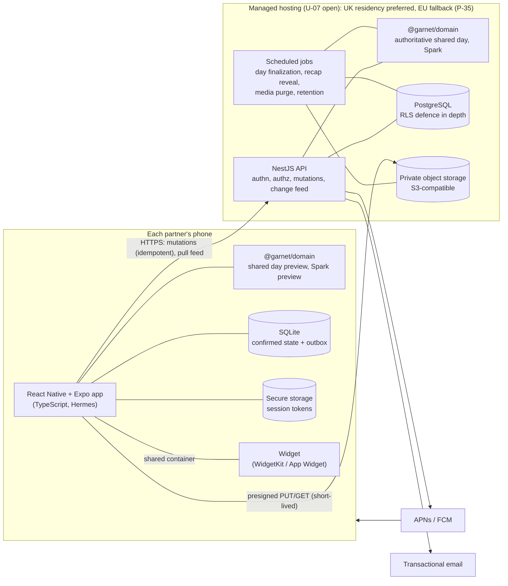

# Architecture overview

Proposed (D-09) and validated where marked. Decisions: [ADRs](../decisions/adr/).

## Components

| Component      | Responsibility                                                                                       | Key rules                                                                        |
| -------------- | ---------------------------------------------------------------------------------------------------- | -------------------------------------------------------------------------------- |
| Mobile app     | UI, offline drafts, outbox sync, media upload, notifications, widget data                            | Offline-first; never decides shared day or Spark authoritatively                 |
| Widget         | Neutral nudges and two deep-link actions                                                             | [features/widget.md](../features/widget.md)                                      |
| API            | Authentication, relationship-scoped authorization, idempotent mutations, change feed, presigned URLs | [api-boundaries.md](./api-boundaries.md), [authorization.md](./authorization.md) |
| Jobs           | Finalize shared days (Spark), reveal recaps, purge media, enforce retention, sweep orphan uploads    | Idempotent; resumable; start in-process; add Redis/BullMQ only if needed (§10)   |
| PostgreSQL     | Source of truth; constraints and RLS encode privacy invariants                                       | [data-model.md](./data-model.md)                                                 |
| Object storage | Private media                                                                                        | [media-lifecycle.md](./media-lifecycle.md)                                       |
| Domain package | Pure rules shared by app, API and jobs                                                               | [ADR-0001](../decisions/adr/0001-monorepo-and-shared-domain.md)                  |

## Request lifecycle (mutation)

1. App appends the mutation (client UUIDv7 ids, `mutationId`, `baseVersion`) to the local outbox, and the UI updates immediately.
2. Sync loop sends the head of the outbox.
3. API authenticates, resolves `(user, relationship)` from the session, and opens a transaction as `garnet_app` with `app.user_id` and `app.mutation_id` set.
4. Idempotency check → tombstone check → version check → apply. Triggers write the tombstone and change-log rows and queue media purges in the same transaction.
5. Respond with the outcome and the entity's **current** state. Push a gentle notification to the partner if appropriate.
6. Partner's device pulls the feed (on push, on foreground, periodically).

## Validated by spikes

| Concern                                  | Spike                                                | Result                                                                           |
| ---------------------------------------- | ---------------------------------------------------- | -------------------------------------------------------------------------------- |
| Time zones & DST                         | [F-06](../feasibility/F-06-timezone-dst.md)          | ✅ Proven — domain, Node only (Hermes unverified)                                |
| Offline sync, retries, deletion          | [F-04](../feasibility/F-04-offline-sync.md)          | ✅ Proven — simulation only (3 design bugs found and fixed)                      |
| Data model, RLS, tombstones, media purge | [F-05](../feasibility/F-05-data-model.md)            | ✅ Proven — database only (purge enqueue only; Open When body gap)               |
| Media upload retry (server side)         | [F-07](../feasibility/F-07-media-retry.md)           | ✅ Verified locally against SeaweedFS (not the chosen provider; not phone-level) |
| Widget                                   | [F-01](../feasibility/F-01-widget.md)                | ⛔ Blocked on U-01                                                               |
| Character performance                    | [F-02](../feasibility/F-02-character-performance.md) | ⛔ Blocked on U-01, U-10                                                         |
| Safe updates preserving drafts           | [F-03](../feasibility/F-03-safe-update.md)           | ⛔ Blocked on U-01                                                               |
