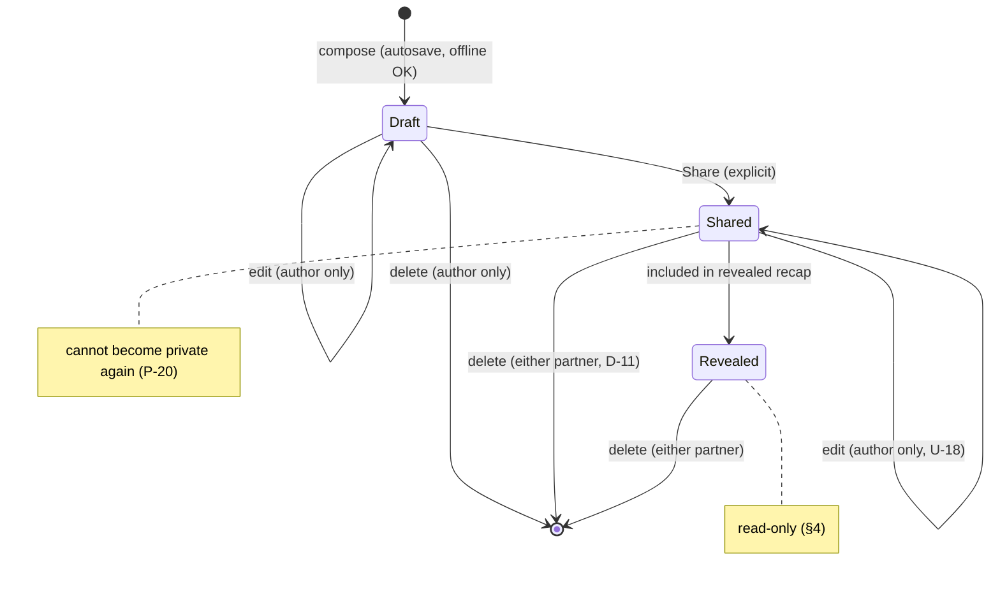

# Day Log and recap

Spec for §4. Data: `entry`, `media`, `tombstone`, `change_log` in [schema.sql](../../spikes/data-model/schema.sql). Sync: [ADR-0003](../decisions/adr/0003-offline-sync-model.md).

## Entry lifecycle

## Rules

| #   | Rule                                                                                                                            | Ref             |
| --- | ------------------------------------------------------------------------------------------------------------------------------- | --------------- |
| 1   | The log is continuous and chronological by `occurred_at`, not an end-of-day form.                                               | §4              |
| 2   | New entries start as private drafts and autosave. "Share" is always an explicit action.                                         | §2, §4          |
| 3   | Ordinary entries may be shared immediately; there is no forced waiting.                                                         | §4              |
| 4   | A private draft is visible, exportable and deletable only by its author. Its existence never leaks (feed, Spark, counts).       | §11, P-10, P-19 |
| 5   | Only the author edits an entry. After recap reveal it is read-only; deletion stays possible.                                    | §4, U-18        |
| 6   | Either partner may delete a shared entry for both, after a confirmation that explains recap and archive effects.                | D-11            |
| 7   | Deletion removes media and leaves a content-free tombstone so no device can resurrect it.                                       | P-05            |
| 8   | Entry kinds: text, photo, video, voice, feeling, activity, food, work, location, custom. First-release subset and limits: U-08. | §4              |
| 9   | Location entries are explicit, never automatic; precise coordinates are not stored unless the author chooses them.              | P-21            |

## Recap

| #   | Rule                                                                                            | Ref      |
| --- | ----------------------------------------------------------------------------------------------- | -------- |
| 1   | A recap covers one shared day's shared entries from both partners.                              | §4       |
| 2   | Available when both partners are ready **or** at a configurable cutoff.                         | §4, U-06 |
| 3   | Urgent emotional signals never wait for recap reveal.                                           | §4       |
| 4   | On reveal, the server sets `revealed_at`; those entries become read-only.                       | §4       |
| 5   | Waiting for the other partner is shown neutrally: no nagging and no "they haven't…".            | §2       |
| 6   | Deleted items in a revealed recap: removed for both; placeholder vs silent removal is **U-06**. | U-06     |
| 7   | Late offline entries arriving after reveal: **U-05**.                                           | U-05     |

## Not decided here

Recap default (ready-or-cutoff timing) U-06 · withdrawing "ready" U-29 · timestamp editing U-11 · late window U-05 · media limits U-08.
