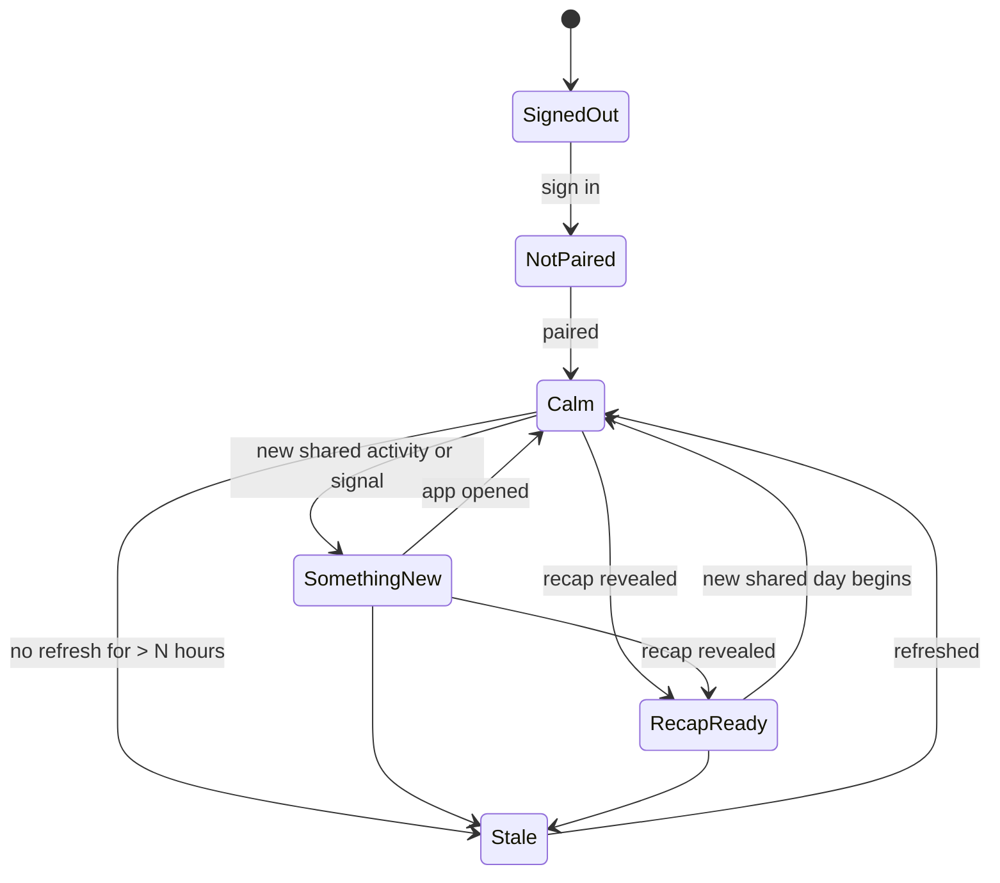

# Widget — Garnet Nudge

Spec for §6 and the widget part of §13D. Platform validation is spike [F-01](../feasibility/F-01-widget.md), which is **blocked on U-01** (which phones).

## Rules

1. **Privacy-neutral at all times.** A home screen is visible to anyone nearby. The widget never shows entry content, names, signal types, urgency, counts of activity, or Spark status that could imply someone missed a day.
2. **Two actions only:** **Add a Moment** and **Open Today's Recap**. Each opens the app; neither creates or shares anything by itself (§6).
3. **Useful without refresh.** The OS controls refresh, so every state must still make sense hours later. Show "Updated 14:05" when content is time-dependent.
4. Respects Spark hidden/muted preferences (§7 Controls).
5. Reduced motion and accessibility apply (VoiceOver/TalkBack labels; no colour-only meaning).

## States

| State        | Shows (neutral)                                  | Tap target | Actions            |
| ------------ | ------------------------------------------------ | ---------- | ------------------ |
| SignedOut    | Garnet mark · "Open Garnet"                      | App        | —                  |
| NotPaired    | "Invite your person"                             | Pairing    | —                  |
| Calm         | A rotating kind nudge from the copy bank         | Home       | Add a Moment       |
| SomethingNew | "Something new for you 💜" (same for every kind) | Day Log    | Add a Moment       |
| RecapReady   | "Today's recap is ready"                         | Recap      | Open Today's Recap |
| Stale        | Last known neutral state + "Updated <time>"      | Home       | Add a Moment       |

"Adaptive contextual content" (§6) means choosing between these neutral states plus time-of-day nudges in the viewer's zone (morning, evening). It never means surfacing content.

## Capability matrix

**Unverified.** This is expected platform behaviour, based on platform knowledge rather than testing. It is to be verified in F-01 on the actual target devices, and nothing here is final until then (§6).

| Capability                       | iOS (WidgetKit)                                                                       | Android (App Widgets)                                                                  |
| -------------------------------- | ------------------------------------------------------------------------------------- | -------------------------------------------------------------------------------------- |
| Implementation                   | Native SwiftUI widget extension; Expo via a config plugin / Apple-targets tooling     | Native (Glance / RemoteViews) or JS-rendered via `react-native-android-widget`         |
| Can be tested in Expo Go         | No — development build required                                                       | No — development build required                                                        |
| Refresh                          | Timeline entries; system-managed reload budget (dozens per day, not guaranteed)       | `updatePeriodMillis` ≥ 30 min; WorkManager ≥ 15 min; app can push updates when it runs |
| Update after a push notification | App can reload timelines when it is woken; widget push updates on recent iOS — verify | FCM data message → app updates the widget (subject to background limits)               |
| Buttons without opening app      | iOS 17+ App Intents                                                                   | Broadcast `PendingIntent`s                                                             |
| Deep link to a screen            | `widgetURL` / `Link`                                                                  | Activity `PendingIntent`                                                               |
| Text input in widget             | No                                                                                    | No                                                                                     |
| Lock screen                      | Accessory families (iOS 16+); `privacySensitive` redaction                            | Not a target                                                                           |
| Shared data with app             | App Group container (mind data-protection class when locked)                          | SharedPreferences / file; same process                                                 |
| Build needs                      | Xcode on macOS **or** EAS cloud build; signing; physical iPhone to test well          | Android SDK (installed on the dev machine), emulator or device                         |

## Copy

Calm-state nudges rotate from the "funny-but-kind" bank: [../ux/voice-and-copy.md](../ux/voice-and-copy.md#widget-nudges).
