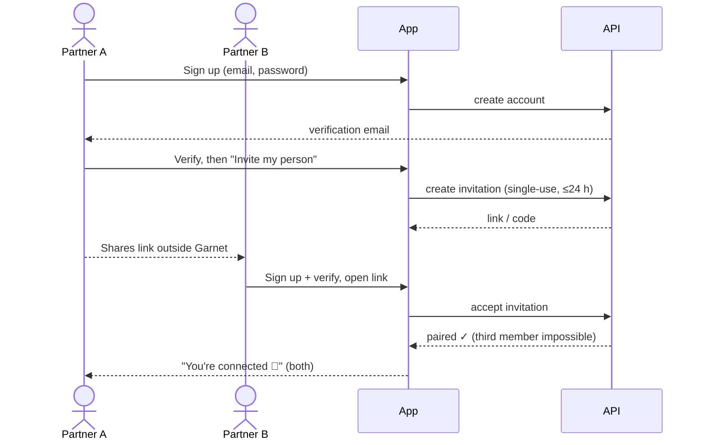

# Primary journeys

The seven journeys required by §13A, written so each step is testable. "Key states" lists the loading, empty, error, offline and retry states each journey must design for (catalogue: [../ux/states.md](../ux/states.md)).

## J1 — Account and pairing

Rules: an invitation is single-use, expires within 24 h, can be revoked by its creator, and an invalid one always gives the same message ("This invite isn't valid anymore — ask for a new one"). A person in an active relationship cannot accept another invitation.

Key states: email not yet verified; invite expired or used; already paired; network lost mid-acceptance (retry is safe because acceptance is atomic).

Open: invitation delivery and lifecycle (U-33); re-pairing after ending (U-32).

## J2 — Start Long Distance (first-run setup)

1. Each partner confirms their home time zone (from the device, editable).
2. The shared-day explainer shows the day boundary **in each person's own time** ("Your shared day starts at 07:00 for you, 04:00 for them"). Depends on U-02.
3. Notification preferences: gentle and support levels, quiet hours (on by default, U-21), lock-screen preview (generic by default).
4. Optional: add the widget (platform-specific guidance, F-01).
5. Optional: Spark visibility (shown by default; can be hidden at any time without loss).

Key states: notification permission denied (the app still works; explain gently); time zone changed while travelling.

## J3 — Log or share a moment

1. "Add a Moment" from Home, Day Log or the widget.
2. Compose text, add a feeling, activity or media. **Autosaves as a private draft.**
3. Choose **Share** (now visible to both) or **Keep private** (only me).
4. Offline: saved locally with a "Will send when you're back online" state; retries automatically.
5. Partner sees it in their Day Log; it counts toward Spark only once shared (P-10).

Rules: the widget never shares without review (§6). Media uploads run in the background and resume after interruption. A shared entry cannot be made private again; it can be deleted (P-20). A conflicting edit made on two devices is never lost (P-15).

Key states: draft saved locally; uploading (progress); upload failed (retry); deleted by partner while offline ("This moment was removed"); read-only after recap reveal.

## J4 — Send a signal

1. Open signals (one tap from Home).
2. Pick one of eight; optionally add a note.
3. Sent. Delivery level follows the signal (P-07): gentle or support.
4. Partner receives a notification respecting **their** quiet hours and preview settings. The app never says "seen" unless that is genuinely known (§5).
5. Partner can reply with a preset ("I'm here ❤️", "Can I call you?", "Give me a little time", "Tell me what's going on") or their own words.
6. "I'm Okay Now" lets the sender gently close a support request.

Rules: signals are never delayed for the recap (§4). No escalation for non-response, no reminder pressure on the recipient.

Key states: sent while offline (queued, then delivered); push permission off on the recipient's side (the sender sees no "undelivered" guilt state); quiet hours active.

## J5 — Recap

1. During the shared day, shared moments appear in the Day Log as they happen.
2. "Today's Recap" becomes available when both partners mark themselves ready, or at the cutoff (U-02, U-06).
3. Recap shows the day's shared moments for both, in each viewer's local time.
4. After reveal, its entries are read-only; deletion is still possible (§4).

Key states: one partner ready, waiting for the other (neutral, no nagging); empty day (kind copy, no guilt); late offline entry arriving after reveal (U-05).

## J6 — Open When

1. The author writes a letter with a prompt ("Open when you miss me").
2. Draft (only the author sees it) → **Seal** → the recipient sees it in their Open When list.
3. The recipient opens it whenever they choose; the opening is a small, private moment.

Text first; photo and voice attachments depend on U-08.

Key states: no letters yet; sealed but unopened; draft autosave.

## J7 — Export and deletion

Three separate actions (§11), each with its own confirmation and an explanation of effects:

| Action                 | Who                | Effect                                                                                                                                                                                              |
| ---------------------- | ------------------ | --------------------------------------------------------------------------------------------------------------------------------------------------------------------------------------------------- |
| Delete a shared memory | Either partner     | Removed for both, including media and recap appearances; tombstoned so no device re-uploads it.                                                                                                     |
| End pairing            | Either partner     | Direction P-37 (proposal): ask during the flow; the remaining partner may export eligible shared memories first; by default the departing partner's entries are removed. Details open (U-20, U-23). |
| Delete my account      | The account holder | Export first; then deliberate deletion; backup retention explained (U-07). Shared memories per P-37 (proposal); details open (U-20, U-23).                                                          |

Export includes only what the requester may see: their own drafts and all shared content, **never** the partner's private drafts (§11). The UI states plainly that deletion cannot erase screenshots, downloads or copies outside Garnet.

Key states: export in progress / ready / expired link; deletion pending with a grace period (only if one is adopted; open question **U-23**); partner informed neutrally.
