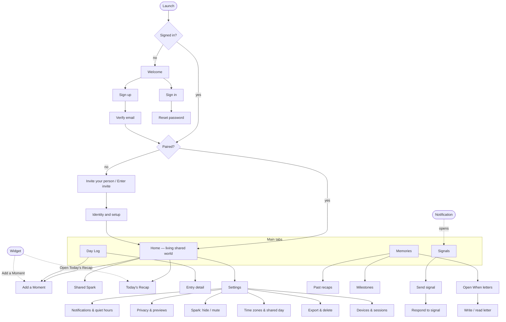

# Sitemap and navigation

Low-fidelity structure for §13B. Visual wireframes are **not yet produced** (they need a design tool); this sitemap and [states.md](./states.md) are their input. Per owner direction **P-34**, wireframes for all core journeys J1–J7, especially J3 and J4, must be reviewed **before any Phase 2 UI implementation** (gate B-04). The clickable prototype is deferred and is not required for Phase 1 sign-off.

## Navigation principles

- **Four tabs:** Home, Day Log, Signals, Memories. Settings is reached from Home.
- **Signals are one tap from anywhere** (persistent action on Home and the Day Log). Support must never be buried.
- **Add a Moment** is the primary action on Home and the Day Log, and the target of the widget.
- **Deep links** (widget, notifications) land on the exact screen with a back path to Home.
- Destructive actions (delete memory, end pairing, delete account) are kept apart in Settings → Export & delete, each with its own confirmation (§11).

## Wireframe list (to produce)

Onboarding · Pairing · Setup · Home · Day Log · Add a Moment · Entry detail · Signals (send / respond) · Recap · Spark · Widget (each state in [features/widget.md](../features/widget.md)) · Open When · Memories · Settings · Export & delete. Each screen must cover the states in [states.md](./states.md).
